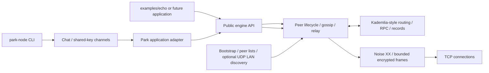

# P2P networking engine and P2P-Park

A Go peer-to-peer network where independent nodes discover one another, establish
encrypted connections, and exchange signed gossip. Run three local processes to
try public chat and shared-key channels. Park is a reference CLI for the engine.

I built P2P-Park to explore how peer discovery, encrypted connections, gossip and
distributed records fit together in a working Go network. The chat demo
makes the network easy to exercise. The parts I wanted to work through were peer
lifecycles, concurrent I/O, XOR-distance routing, signed state and what happens
when peers send malformed data or stop responding.

This is an experimental portfolio project. It is not a production messaging
system, and its protocol has not been independently verified or audited. See
[SECURITY.md](SECURITY.md) and the [engineering review](docs/SECURITY_REVIEW.md)
for the threat model and [Pass 2 review](docs/PASS2_REVIEW.md) for baseline findings,
test evidence and resource budgets. The [final review](docs/FINAL_REVIEW.md) records
the prior portfolio merge assessment, compatibility and remaining limitations.
The [Phase 1 review](docs/ENGINE_REVIEW.md) records the extraction; the
[Phase 2 adapter review](docs/PHASE2_ENGINE_ADAPTER.md) describes Park as a consumer.

## SDK preview

The canonical import is `github.com/TylerPetri/p2p-networking-project/engine`.
From your own Go module, run:

```sh
go get github.com/TylerPetri/p2p-networking-project/engine@FULL_REVIEWED_COMMIT
```

Replace the placeholder with the reviewed pushed commit; a preview tag will be
cut only with owner approval. Go 1.24.1 is the minimum. Linux and macOS are the
preview targets; native Windows is unsupported (use Linux in WSL2). See the
[SDK guide](engine/README.md) and [release/verification checklist](docs/SDK_PREVIEW.md)
for install commands, actual CI evidence and the proposed `v0.1.0-preview.1` tag.
The existing limited evaluation license remains in effect.

## Application-independent engine and Park consumer

The public [`engine`](engine/README.md) package lets a Go application create or
join an overlay, persist an identity, bootstrap/discover peers, send authenticated
messages, use validated DHT records and observe peer events. It builds on the
existing networking implementation. Park is a reference consumer of the
public API. Its chat schemas and shared-key channels live in the application.
The engine owns peer admission and resource limits. Public streaming and
private tools can use the same open network while enforcing their own
application permissions. See [release readiness](docs/RELEASE_READINESS.md).

```sh
go run ./examples/echo
```

This standalone example uses public invitation URIs to join three loopback
engine nodes, verifies discovery and communication after bootstrap loss, and
reconnects through another peer without importing game code. It creates and removes temporary
identity files, closes all nodes and prints `PASS`. For configuration, API error
and concurrency semantics, see the [API guide](engine/README.md); for the package
boundary map, admission choices and future extraction path, see the
[architecture assessment](docs/ENGINE_ARCHITECTURE.md).

Engine peers use `p2p-engine/0.1.0`, a public network identifier and either open
admission or static approved-peer admission. Current Park uses application namespace `p2p-park.0.3.0` on that engine. Legacy
Park `0.2.0` peers are incompatible; there is no version negotiation. Membership is separate from
application authorization. The engine API exposes verified messages, not raw
control envelopes or private signing keys. This remains experimental networking,
not a production security or enterprise authorization platform.

## Public network invitations

The engine can encode public bootstrap addresses and expected Noise/Ed25519 keys
in a canonical `p2p://invite/...` URI suitable for sharing as link or QR text.
No account or shared password is required. Invitations do not grant application
permissions or certify their issuer; obtain them through a trusted source.
Private/local destinations require separate receiver approval. Applications can wrap bootstrap in an HTTPS join page for a browser-friendly link or QR.

See the [invitation specification](docs/INVITATIONS.md) and
[Phase 3 API/security review](docs/PHASE3_API_REVIEW.md). Numeric endpoints and
multiple peers help bootstrap an overlay; they do not solve NAT/firewall traversal.
The three-node demo is a localhost test, not proof of Internet-wide connectivity.

## Architecture



- `internal/netx` abstracts the transport; TCP is the supplied implementation.
- `internal/crypto/noiseconn` implements a length-prefixed byte stream using
  `github.com/flynn/noise`: XX, X25519, ChaCha20-Poly1305, BLAKE2s. Ciphertext
  frames are capped at 65,535 bytes before allocation; larger writes are split.
  A separate 128 KiB newline-delimited JSON envelope limit applies across frames.
- Each connection verifies its peer ID against the Noise static key. An Ed25519
  signature binds the separate signing key to that static key. This proves key
  possession, not a person's identity or trustworthiness. Keys are generated
  on Park startup by default. Park can accept an explicit persistent engine identity;
  neither interface provides a trusted-key directory.
  Optional outbound `-pins address=Noise-ID` checks an expected key supplied by
  the operator; it does not silently trust a key on first use.
- `internal/p2p` owns peer sessions, bounded connections and outbound queues,
  signed gossip and deduplication,
  and optional seed rendezvous/relay. Seeds are peers with additional duties;
  deployments using them depend on their availability.
- `internal/dht` validates immutable content hashes and mutable Ed25519 signatures,
  key derivation, expiry, size and sequence constraints. Routing/referral checks
  and rate limits reduce some abuse; they do not establish Sybil resistance.
- Shared-key application channels use XChaCha20-Poly1305. These are separate
  from Noise transport encryption. Channel names are AEAD associated data; the
  surrounding gossip signature identifies its signer. Any key holder can create
  ciphertext, so the key alone does not identify a person.

The protocol is **not X3DH**. Origin signatures establish key possession;
referrals, names, authorization, DHT freshness and human identity need additional
trust. There is no independent verification of protocol security.

## Discovery, trust and the DHT

1. Explicit `-bootstrap host:port` addresses start a connection. These are operator
   choices; add `-pins host:port=<64-hex Noise key>` when the expected identity is
   known through a separate trusted channel. `/me` prints full IDs.
2. Peers exchange bounded peer lists. Optional UDP LAN discovery advertises a
   listening port; the observed source IP supplies the host. Automatic discovery
   accepts numeric IPs only, defaults to same-host referrals (plus loopback when
   bound to loopback), and uses a bounded worker queue. Cross-host LAN discovery
   requires an explicit range, for example `-discover-cidrs 192.168.1.0/24` on a
   trusted test LAN. Avoid broad ranges; every allowed peer can suggest ports
   inside them. Link-local, multicast and unspecified destinations are rejected.
3. The DHT contributes XOR-distance routing and FIND_NODE/FIND_VALUE/STORE RPCs.
   Node IDs derive from transport IDs; referrals must match that derivation.
   Immutable records are content addressed; mutable records bind a signing key,
   name, sequence, expiry and value. This supports routing/record experiments;
   chat delivery uses gossip, and DHT replicas do not provide consensus.
4. A referred peer must prove possession of the advertised Noise key before
   admission. Successfully dialing a TCP socket alone establishes no trust.

```mermaid
sequenceDiagram
    participant A as Initiator
    participant B as Responder
    A->>B: Noise XX ephemeral key
    B->>A: XX response + signed signing-key/static-key binding
    A->>B: XX completion + signed identity binding
    A->>B: Encrypted Hello (peer ID, protocol, listen port)
    B->>A: Encrypted Hello
    Note over A,B: Check bindings, expected outbound pin, protocol and budgets
    A->>B: Signed timestamped gossip inside bounded encrypted frames
    Note over A,B: Relays preserve signatures; receivers check replay window
```

Park transport keys and signing keys stay in process memory and are regenerated
at startup. The engine can explicitly persist these keys in a private plaintext
identity file; it does not automatically rotate them. Channel keys are generated with `crypto/rand`, displayed only when
explicitly creating a channel, and shared out of band. No automatic key-rotation protocol is implemented.

## Local three-node demo

Use Linux or macOS, a current Go toolchain (module minimum Go 1.24.1; this review
used Go 1.27.3), a C compiler for race tests, and Python 3 for the automated demo.
No public seed, account, container or external service is needed after dependency
downloads. Windows is not supported by the current Unix LAN socket implementation.

```sh
python3 scripts/demo.py
```

The script builds into a temporary directory, starts a seed plus Alice and Bob on
OS-selected loopback ports, disables LAN discovery, and checks that Bob receives
Alice's signed gossip and decrypts a shared-channel message. It prints `PASS`
and shuts down all three processes. Each node gets isolated temporary application
state, which is removed on exit.

For an interactive version, build once and run these commands in three terminals
from the repository root (choose other ports if these are occupied):

```sh
go build -o /tmp/park-node ./cmd/park-node

# Terminal 1
/tmp/park-node -name seed -seed -bind 127.0.0.1:43001 -lan=false -data /tmp/park-demo-seed
# Terminal 2
/tmp/park-node -name alice -bind 127.0.0.1:43002 -lan=false -bootstrap 127.0.0.1:43001 -data /tmp/park-demo-alice
# Terminal 3
/tmp/park-node -name bob -bind 127.0.0.1:43003 -lan=false -bootstrap 127.0.0.1:43001 -data /tmp/park-demo-bob
```

Enter `/peers` to inspect connections and `/say hello` on Alice to see the message
on Bob. `/mkchan friends` creates a shared-key channel; copy its key privately to
Bob with `/joinchan friends <hexkey>`, then `/encsay friends hello`. Use disposable
demo keys. `/quit` or Ctrl-C exits. `-data` isolates peer discovery state and overrides `P2P_PARK_DATA_DIR`. LAN discovery is enabled by default
outside this demo and advertises/responds on UDP port 42042.

## Verification

```sh
go vet ./...
go test -count=1 ./...
go test -race -count=1 ./...
go test -race -count=10 ./engine ./internal/park-node
python3 scripts/check_engine_boundary.py
go test -race -count=20 ./internal/crypto/noiseconn ./internal/dht ./internal/crypto/channel
go test -race -count=10 -run 'TestSession|TestIdentify|TestStop|TestGossip|TestNAT|TestEncrypted|TestDHT' ./internal/p2p
# Optional: real UDP broadcast tests; run only on an isolated test network.
P2P_LAN_UDP_TEST=1 go test -race -count=1 ./internal/discovery

# Scan all locally fetched Git history; do not post unredacted findings.
go install github.com/zricethezav/gitleaks/v8@v8.24.3
gitleaks git --log-opts='--all --full-history' --redact .
```

CI runs vet, the uncached ordinary and race suites, repeated transport/DHT/P2P
tests, short fuzz runs, the signed/encrypted localhost demo and a history secret
scan. Passing race tests is evidence for the exercised
schedules, not proof of concurrency safety. The review adds tests for malicious
framing, partial I/O, buffered reads, ciphertext replay/tampering, identity claims,
RPC response sources, record validation and cancellation.

The current core protocol is `p2p-engine/0.1.0`, with Park application namespace
`p2p-park.0.3.0`: mutual identity bindings, signed
gossip and channel-name associated data are required. Older revisions are
incompatible; all demo nodes must use the same revision. There is no version
negotiation or rolling-upgrade guarantee. Empty, older and unknown Hello protocol
versions are rejected before peer admission. The internal transport abstraction
allows explicit test protocols; the shipped application uses the engine
version and a versioned message namespace. Existing TCP, Noise XX, gossip, DHT and relay architecture is retained.

## Security boundaries and resource budgets

Defaults admit 32 pending/live connections together, 16 queued messages per peer,
128 KiB per envelope and two minutes to complete each message (including idle
wait). Setup/dial/TCP writes retain five-second bounds. Stop closes and joins node
sessions and tracked workers; a custom transport must unblock on Close.

The DHT cache holds at most 256 records / 8 MiB of accounted record data. Gossip
replay state holds 8,192 entries over the signed five-minute window; successfully
decrypted ciphertext replay state holds 4,096 entries for 24 hours. Caches fail
closed when full. See the security documentation for application replay limits. These are component budgets, not a hard process-RSS
or disk-usage guarantee.

An attacker can occupy capacity or exhaust a replay cache, create many identities,
withhold records, lie about names or suggest ports inside approved ranges. Pins
are optional and address-specific; replay caches are volatile; immutable expiry
metadata is not hash-bound. DHT immutable/mutable keys share a namespace: retained record
types cannot change, but an untyped lookup still needs a caller check of its
intended type. Use disposable data on a controlled local network. This is
ready to discuss as an engineering experiment, not as an audited secure messenger.

Practical fuzz commands (short smoke runs, not exhaustive campaigns):

```sh
go test ./engine -run '^$' -fuzz '^FuzzInvitationParse$' -fuzztime=10s -parallel=2
go test ./internal/p2p -run '^$' -fuzz '^FuzzEnvelopeDecoder$' -fuzztime=10s -parallel=2
go test ./internal/dht -run '^$' -fuzz '^FuzzRecordValidation$' -fuzztime=10s -parallel=2
go test ./internal/crypto/channel -run '^$' -fuzz '^FuzzChannelDecrypt$' -fuzztime=10s -parallel=2
```

## Phase 4 compatibility and connectivity evidence

The [API/version policy](docs/API_VERSION_POLICY.md) separates experimental Go API,
wire and invitation compatibility. Deterministic Go/Python invitation fixtures
and an independently built Go consumer run in CI.

For actual two-machine testing, use the [owner-run connectivity plan](docs/CROSS_HOST_TEST_PLAN.md)
and `go build -o /tmp/p2p-netcheck ./examples/netcheck`. The diagnostic defaults
to loopback and requires explicit authorization flags for non-loopback binding.
Automated diagnostics in this repository exercise loopback. The maintainer
reports successful multi-host and multi-device connectivity. See
[release readiness](docs/RELEASE_READINESS.md) for the recorded scope. [The Phase 4 review](docs/PHASE4_REVIEW.md) covers relay visibility,
remaining limits. The current [SDK preview checklist](docs/SDK_PREVIEW.md) supersedes its historical packaging assessment; no separate repository or module is created.

## License

Copyright © 2026 Tyler Petri. Rights to the original implementation are reserved
under [LICENSE.txt](LICENSE.txt); this is not an open-source license. You may
clone, build, run tests and execute the project locally for personal technical
evaluation or recruitment/hiring review, including review by a commercial
employer. That limited permission does not grant production use, commercial
redistribution or general modification rights.

[Third-party notices](THIRD_PARTY_NOTICES.md) preserve the independent MIT/BSD
terms and attribution requirements of upstream components. The original-code
permission does not restrict rights those licenses grant. The protocol remains
experimental and has not been independently security-audited. See the
[custom-license review notes](THIRD_PARTY_NOTICES.md#custom-license-review-notes)
for the points recommended for professional legal review.
