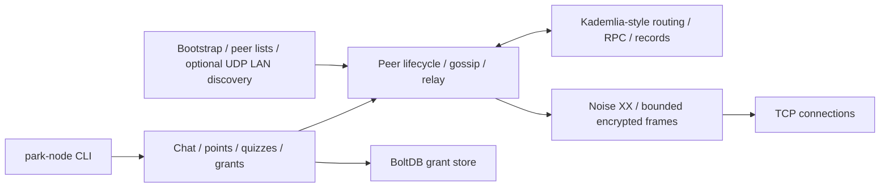

# P2P-Park

A Go peer-to-peer network where independent nodes discover one another, establish
encrypted connections, and exchange signed gossip. Run three local processes to
try chat, shared-key channels, signed points snapshots, quizzes and persisted grants.

The engineering goal is to explore the boundary between working distributed
systems and defensible protocol behavior: transport abstraction, concurrent peer
lifecycles, discovery, XOR-distance routing, signed mutable state, replay handling
and adversarial resource budgets. TCP, Noise XX, gossip and a Kademlia-style DHT
remain the core design; the interactive app makes their behavior visible.

This is an experimental portfolio project. It is not a production messaging
system, and its protocol has not been independently verified or audited. See
[SECURITY.md](SECURITY.md) and the [engineering review](docs/SECURITY_REVIEW.md)
for the threat model and [Pass 2 review](docs/PASS2_REVIEW.md) for current findings,
test evidence, resource budgets and remaining limitations.

## Architecture



- `internal/netx` abstracts the transport; TCP is the supplied implementation.
- `internal/crypto/noiseconn` implements a length-prefixed byte stream using
  `github.com/flynn/noise`: XX, X25519, ChaCha20-Poly1305, BLAKE2s. Ciphertext
  frames are capped at 65,535 bytes before allocation; larger writes are split.
  A separate 128 KiB newline-delimited JSON envelope limit applies across frames.
- Each connection binds its network ID to the Noise static key. An Ed25519
  signature binds the separate signing key to that static key. This proves key
  possession, not a person's identity or trustworthiness. Keys are generated
  on each node start; there is no persistent identity or trusted-key directory.
  Optional outbound `-pins address=Noise-ID` checks an expected key supplied by
  the operator; it does not silently trust a key on first use.
- `internal/p2p` owns peer sessions, bounded connections and outbound queues, signed gossip and deduplication,
  and optional seed rendezvous/relay. Seeds are peers with additional duties;
  deployments using them depend on their availability.
- `internal/dht` validates immutable content hashes and mutable Ed25519 signatures,
  key derivation, expiry, size and sequence constraints. Routing/referral checks
  and rate limits reduce some abuse; they do not establish Sybil resistance.
- Shared-key application channels use XChaCha20-Poly1305. These are separate
  from Noise transport encryption. Channel names are AEAD associated data; the
  surrounding gossip signature identifies its signer. Any key holder can create
  ciphertext, so the key alone does not identify a person.

The protocol is **not X3DH**. Origin signatures establish key possession;
referrals, names, authorization, DHT freshness and human identity need additional
trust. There is no independent verification of protocol security.

## Discovery, trust and the DHT

1. Explicit `-bootstrap host:port` addresses start a connection. These are operator
   choices; add `-pins host:port=<64-hex Noise key>` when the expected identity is
   known through a separate trusted channel. `/me` prints full IDs.
2. Peers exchange bounded peer lists. Optional UDP LAN discovery advertises a
   listening port; the observed source IP supplies the host. Automatic discovery
   accepts numeric IPs only, defaults to same-host referrals (plus loopback when
   bound to loopback), and uses a bounded worker queue. Cross-host LAN discovery
   requires an explicit range, for example `-discover-cidrs 192.168.1.0/24` on a
   trusted test LAN. Avoid broad ranges; every allowed peer can suggest ports
   inside them. Link-local, multicast and unspecified destinations are rejected.
3. The DHT contributes XOR-distance routing and FIND_NODE/FIND_VALUE/STORE RPCs.
   Node IDs derive from transport IDs; referrals must match that derivation.
   Immutable records are content addressed; mutable records bind a signing key,
   name, sequence, expiry and value. This supports routing/record experiments;
   chat delivery uses gossip, and DHT replicas do not provide consensus.
4. A referred peer must prove possession of the advertised Noise key before
   admission. Successfully dialing a TCP socket alone establishes no trust.

```mermaid
sequenceDiagram
    participant A as Initiator
    participant B as Responder
    A->>B: Noise XX ephemeral key
    B->>A: XX response + signed signing-key/static-key binding
    A->>B: XX completion + signed identity binding
    A->>B: Encrypted Hello (network ID, protocol, listen port)
    B->>A: Encrypted Hello
    Note over A,B: Check bindings, expected outbound pin, protocol and budgets
    A->>B: Signed timestamped gossip inside bounded encrypted frames
    Note over A,B: Relays preserve signatures; receivers check replay window
```

Transport keys and signing keys stay in process memory and are regenerated at
startup. Channel keys are generated with `crypto/rand`, displayed only when
explicitly creating a channel, and shared out of band. No automatic persistent
key storage or rotation protocol is implemented.

## Local three-node demo

Use Linux or macOS, a current Go toolchain (module minimum Go 1.24.1; this review
used Go 1.27.3), a C compiler for race tests, and Python 3 for the automated demo.
No public seed, account, container or external service is needed after dependency
downloads. Windows is not supported by the current Unix LAN socket implementation.

```sh
python3 scripts/demo.py
```

The script builds into a temporary directory, starts a seed plus Alice and Bob on
OS-selected loopback ports, disables LAN discovery, and checks that Bob receives
Alice's signed gossip and decrypts a shared-channel message. It prints `PASS`
and shuts down all three processes. Each node
gets isolated temporary application state, which is removed on exit.

For an interactive version, build once and run these commands in three terminals
from the repository root (choose other ports if these are occupied):

```sh
go build -o /tmp/park-node ./cmd/park-node

# Terminal 1
P2P_PARK_DATA_DIR=/tmp/park-demo-seed /tmp/park-node -name seed -seed -bind 127.0.0.1:43001 -lan=false -data /tmp/park-demo-seed
# Terminal 2
P2P_PARK_DATA_DIR=/tmp/park-demo-alice /tmp/park-node -name alice -bind 127.0.0.1:43002 -lan=false -bootstrap 127.0.0.1:43001 -data /tmp/park-demo-alice
# Terminal 3
P2P_PARK_DATA_DIR=/tmp/park-demo-bob /tmp/park-node -name bob -bind 127.0.0.1:43003 -lan=false -bootstrap 127.0.0.1:43001 -data /tmp/park-demo-bob
```

Enter `/peers` to inspect connections and `/say hello` on Alice to see the message
on Bob. `/mkchan friends` creates a shared-key channel; copy its key privately to
Bob with `/joinchan friends <hexkey>`, then `/encsay friends hello`. Use disposable
demo keys. `/quit` or Ctrl-C exits. The environment variable isolates discovery
state; `-data` isolates the grant database. LAN discovery is enabled by default
outside this demo and advertises/responds on UDP port 42042.

## Verification

```sh
go vet ./...
go test -race -count=1 ./...
go test -race -count=20 ./internal/crypto/noiseconn ./internal/dht ./internal/crypto/channel
go test -race -count=10 -run 'TestSession|TestIdentify|TestStop|TestGossip|TestNAT|TestEncrypted|TestDHT' ./internal/p2p
# Optional: real UDP broadcast tests; run only on an isolated test network.
P2P_LAN_UDP_TEST=1 go test -race -count=1 ./internal/discovery

# Scan all locally fetched Git history; do not post unredacted findings.
go install github.com/zricethezav/gitleaks/v8@v8.24.3
gitleaks git --log-opts='--all --full-history' --redact .
```

CI runs vet, the race suite, repeated transport/DHT/P2P tests, the localhost demo,
short fuzz runs, encrypted-channel delivery in the demo, and a history secret scan. Passing race tests is evidence for the exercised
schedules, not proof of concurrency safety. The review adds tests for malicious
framing, partial I/O, buffered reads, ciphertext replay/tampering, identity claims,
RPC response sources, record validation and cancellation.

The application protocol is `park-p2p/0.2.0`: mutual identity bindings, signed
gossip and channel-name associated data are required. Older revisions are
incompatible; all demo nodes must use the same revision. Existing TCP, Noise XX, gossip, DHT and relay architecture is retained.

## Security boundaries and resource budgets

Defaults admit 32 pending/live connections together, 16 queued messages per peer,
128 KiB per envelope and two minutes to complete each message (including idle
wait). Setup/dial/TCP writes retain five-second bounds. Stop closes and joins node
sessions and tracked workers; a custom transport must unblock on Close.

The DHT cache holds at most 256 records / 8 MiB of accounted record data. Gossip
replay state holds 8,192 entries over the signed five-minute window; successfully
decrypted ciphertext replay state holds 4,096 entries for 24 hours. Caches fail
closed when full. Application maps, grant sync and grant persistence have separate
caps documented in the review. These are component budgets, not a hard process-RSS
or disk-usage guarantee.

An attacker can occupy capacity or exhaust a replay cache, create many identities,
withhold records, lie about names or suggest ports inside approved ranges. Pins
are optional and address-specific; replay caches are volatile; immutable expiry
metadata is not hash-bound. Signed scores/grants prove who issued them, not whether
the awards are fair. Use disposable data on a controlled local network. This is
ready to discuss as an engineering experiment, not as an audited secure messenger.

Practical fuzz commands (short smoke runs, not exhaustive campaigns):

```sh
go test ./internal/p2p -run '^$' -fuzz '^FuzzEnvelopeDecoder$' -fuzztime=10s -parallel=2
go test ./internal/dht -run '^$' -fuzz '^FuzzRecordValidation$' -fuzztime=10s -parallel=2
go test ./internal/crypto/channel -run '^$' -fuzz '^FuzzChannelDecrypt$' -fuzztime=10s -parallel=2
```

## License

Copyright © 2026 Tyler Petri. All rights reserved. This is source available for
portfolio evaluation under the existing [LICENSE.txt](LICENSE.txt), not an
open-source license. The license terms remain unchanged.
