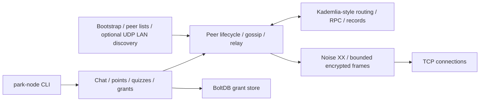

# P2P-Park

A Go engineering project exploring encrypted peer connections, gossip, peer
discovery, and a Kademlia-style DHT. The interactive app adds chat, shared-key
channels, signed points snapshots, quizzes, and persisted quiz grants.

This is an experimental portfolio project. It is not a production messaging
system, and its protocol has not been independently verified or audited. See
[SECURITY.md](SECURITY.md) and the [engineering review](docs/SECURITY_REVIEW.md)
for the threat model, findings, tests, and remaining limitations.

## Architecture



- `internal/netx` abstracts the transport; TCP is the supplied implementation.
- `internal/crypto/noiseconn` implements a length-prefixed byte stream using
  `github.com/flynn/noise`: XX, X25519, ChaCha20-Poly1305, BLAKE2s. Ciphertext
  frames are capped at 65,535 bytes before allocation; larger writes are split.
- Each connection binds its network ID to the Noise static key. An Ed25519
  signature binds the separate signing key to that static key. This proves key
  possession, not a person's identity or trustworthiness. Keys are generated
  on each node start; there is no persistent identity or trusted-key directory.
- `internal/p2p` owns peer sessions, bounded outbound queues, gossip deduplication,
  and optional seed rendezvous/relay. Seeds are peers with additional duties;
  deployments using them depend on their availability.
- `internal/dht` validates immutable content hashes and mutable Ed25519 signatures,
  key derivation, expiry, size and sequence constraints. Routing/referral checks
  and rate limits reduce some abuse; they do not establish Sybil resistance.
- Shared-key application channels use XChaCha20-Poly1305. These are separate
  from Noise transport encryption and do not authenticate individual senders.

The protocol is **not X3DH**. Transport encryption does not make unsigned gossip,
peer referrals, application sender labels, or all DHT metadata trustworthy.

## Local three-node demo

Use Linux or macOS, a current Go toolchain (module minimum Go 1.24.1; this review
used Go 1.27.3), a C compiler for race tests, and Python 3 for the automated demo.
No public seed, account, container or external service is needed after dependency
downloads. Windows is not supported by the current Unix LAN socket implementation.

```sh
python3 scripts/demo.py
```

The script builds into a temporary directory, starts a seed plus Alice and Bob on
OS-selected loopback ports, disables LAN discovery, and checks that Bob receives
Alice's gossip. It prints `PASS` and shuts down all three processes. Each node
gets isolated temporary application state, which is removed on exit.

For an interactive version, build once and run these commands in three terminals
from the repository root (choose other ports if these are occupied):

```sh
go build -o /tmp/park-node ./cmd/park-node

# Terminal 1
P2P_PARK_DATA_DIR=/tmp/park-demo-seed /tmp/park-node -name seed -seed -bind 127.0.0.1:43001 -lan=false -data /tmp/park-demo-seed
# Terminal 2
P2P_PARK_DATA_DIR=/tmp/park-demo-alice /tmp/park-node -name alice -bind 127.0.0.1:43002 -lan=false -bootstrap 127.0.0.1:43001 -data /tmp/park-demo-alice
# Terminal 3
P2P_PARK_DATA_DIR=/tmp/park-demo-bob /tmp/park-node -name bob -bind 127.0.0.1:43003 -lan=false -bootstrap 127.0.0.1:43001 -data /tmp/park-demo-bob
```

Enter `/peers` to inspect connections and `/say hello` on Alice to see the message
on Bob. `/mkchan friends` creates a shared-key channel; copy its key privately to
Bob with `/joinchan friends <hexkey>`, then `/encsay friends hello`. Use disposable
demo keys. `/quit` or Ctrl-C exits. The environment variable isolates discovery
state; `-data` isolates the grant database. LAN discovery is enabled by default
outside this demo and advertises/responds on UDP port 42042.

## Verification

```sh
go vet ./...
go test -race -count=1 ./...
go test -race -count=20 ./internal/crypto/noiseconn ./internal/dht ./internal/crypto/channel
go test -race -count=10 -run 'TestSession|TestIdentify|TestStop|TestGossip|TestNAT|TestEncrypted|TestDHT' ./internal/p2p
# Optional: real UDP broadcast tests; run only on an isolated test network.
P2P_LAN_UDP_TEST=1 go test -race -count=1 ./internal/discovery

# Scan all locally fetched Git history; do not post unredacted findings.
go install github.com/zricethezav/gitleaks/v8@v8.24.3
gitleaks git --log-opts='--all --full-history' --redact .
```

CI runs vet, the race suite, repeated transport/DHT/P2P tests, the localhost demo,
and a history secret scan. Passing race tests is evidence for the exercised
schedules, not proof of concurrency safety. The review adds tests for malicious
framing, partial I/O, buffered reads, ciphertext replay/tampering, identity claims,
RPC response sources, record validation and cancellation.

The identity payload now requires a signing-key binding in both XX directions;
older nodes without that binding are rejected. All demo nodes must use the same
revision. Existing TCP, Noise XX, gossip, DHT and relay architecture is retained.

## License

Copyright © 2026 Tyler Petri. All rights reserved. This is source available for
portfolio evaluation under the existing [LICENSE.txt](LICENSE.txt), not an
open-source license. The license terms remain unchanged.
