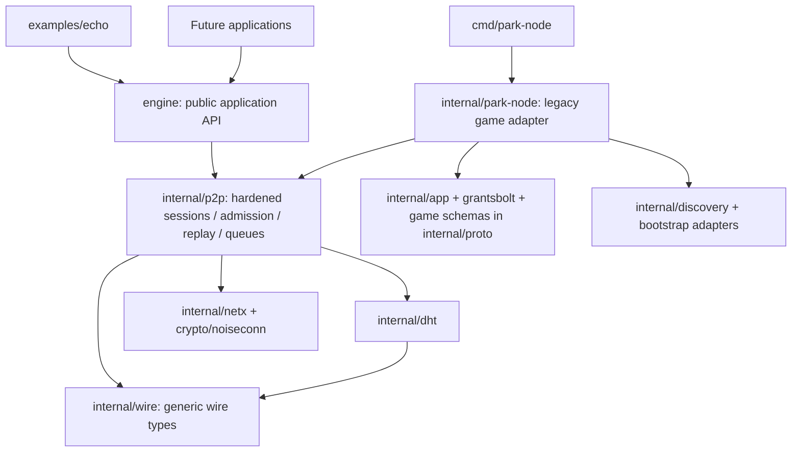

# Phase 1: networking engine extraction

Baseline: merged main `b6cfb37` (PR #1). All security, final-review, protocol,
license and dependency documents remain applicable; this is still experimental.
No game features or new cryptographic primitives are part of this extraction.

## Assessment and decision record

Before extraction, `cmd/park-node -> internal/park-node -> {p2p, discovery,
app/quiz, app/points, app/grants, storage/grantsbolt}`. `p2p -> {proto, dht,
netx, crypto/noiseconn, telemetry}`; `dht -> {proto, appdata}`. The `proto`
package mixes generic wire definitions with game schemas, while discovery and
bootstrap adapters directly depend on the concrete Node. Node generates ephemeral
identities, owns a default game-named peer-store path, and exposes raw envelopes
and signing keys internally. These are poor public application boundaries.

Options considered:

1. Move all transport/DHT/discovery packages and the game at once into a new
   module: creates a large import/API/protocol migration and premature versioning.
2. Expose the current internal Node or alias it publicly: allows raw control-message
   injection, exposes mutable private keys, and makes game protocol details public.
3. Add a narrow public facade, extract shared wire schemas, and add only the core
   hooks required for identity/domain/admission/lifecycle: **chosen**. This builds
   on the tested Node, avoids two independent engines, and lets the old game run
   during incremental migration. No separate module or repository is justified yet.

The existing game remains a legacy application of the same internal transport;
it does not yet consume the public facade. Migrating its custom signing, grant
sync and CLI is Phase 2, not hidden behind an unsafe public `RawNode` escape hatch.
The new standalone example and public API cannot import game packages. The legacy
`internal/proto` keeps wire type aliases for game/test compatibility; networking
uses `internal/wire` directly and has no dependency on the game schema package.

The [measured dependency map](PACKAGE_DEPENDENCIES.md) records the resulting
production imports; the [API guide](../engine/README.md) defines the public lifecycle.

## Boundaries

Generic: TCP abstraction, Noise framing/handshake, key binding, identity validation,
session queues/limits, signed gossip/replay, referral policy, events, DHT routing,
RPC and record validation. Game-specific: chat formatting, channel UI, points,
quiz authority/grants, grant synchronization/storage, stdin CLI and game schemas.
LAN collection is generic but its current manager/bootstrap wiring is legacy-app
integration; the public facade initially uses explicit bootstrap, peer lists and
DHT discovery, not an implicit LAN broadcast worker.

## Identity, domain and policy

- **Transport peer identity:** stable Noise/X25519 static public key, hex PeerID.
- **Signing identity:** separate Ed25519 key, cryptographically bound to that static
  key; signed message origin carries its public key. Neither key is a human name.
- **Network identity:** a public random 32-byte overlay ID, distinct from peer IDs
  and application names. Sharing it is not proof of membership or a secret.
- **Membership/admission:** OPEN accepts any correctly bound identity within budgets;
  RESTRICTED is a static approved-transport-ID set. Both Hello admission and relayed
  signed origins enforce the local policy. No dynamic approval service, roles,
  revocation protocol, enterprise directory or application authorization is implied.
- **Application authorization:** the application's decision whether a verified
  member may perform a business/game action. It must validate content and authority.
  A topic/application label is a routing namespace, not a security sandbox.

The engine protocol `p2p-engine/0.1.0` uses the same Noise/signature primitives and
adds a required Hello network ID plus network ID and optional direct recipient
inside the signed envelope. Mismatched domains/versions fail before admission.
Network-bound signatures cannot be replayed into another engine overlay. Direct
messages are recipient-bound and are never forwarded as broadcast gossip.

Park remains `park-p2p/0.2.0`, with empty optional new fields. Omitting those fields
preserves old signed bytes. Engine/Park protocol versions intentionally do not
interoperate directly. There is no negotiation, bridge or rolling-upgrade promise.
Run the same revision on peers. Names/topics do not establish membership, and a
restricted node must approve every gossip origin it wants to receive via relays.

## Extraction path and Phase 2

Keep the public API in `engine` independent of internal types. A future repository
can move this package and its generic internal dependency closure together, change
its module path, and offer an old-path compatibility module/re-export facade for
a deprecation period. No module is published in this phase. Consumers use a local
`replace` during evaluation; no stable semver/import-path promise is made yet.

Recommended Phase 2: migrate game message signing and grant sync onto explicit
application APIs, add a game adapter that consumes the facade, then move legacy
schemas/adapters fully out of networking. Evaluate authenticated LAN discovery as
an optional adapter and typed DHT namespaces separately. Persistent replay state,
dynamic membership/revocation and key rotation need their own threat model/version
proposal. Do not expand this phase into enterprise authorization or game features.

Existing Sybil/capacity exhaustion, optional pin trust, permitted-range probing,
volatile replay, DHT freshness/shared record namespace, terminal and application
authority limits remain. Persistent keys are plaintext on disk with restrictive
permissions, not encrypted keystore or secure-erasure guarantees. Reuse is a
technical capability; the existing proprietary evaluation license does not grant
third parties commercial/business deployment rights.
