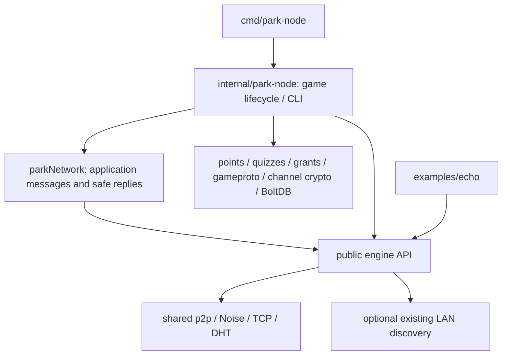

# Phase 2: Park as an engine consumer

## Baseline and repository status

Reviewed main `b6cfb37` and Phase 1 final head `d578349`. At the start of this
work, GitHub PR #2 and main both showed Phase 1 **unmerged**, despite the requested
baseline describing it as merged. This branch builds on that tested Phase 1 head;
its PR targets `engine/extraction-phase1` so the migration diff stays reviewable.
No merge, history rewrite, publication, license change or deployment was performed.
After Phase 1 is merged, the maintainer can retarget this PR to main.

The Phase 1 assessment and review are historical records. This document and the
updated package map describe the current application boundary.

## Dependency assessment and implementation

Before: `cmd/park-node -> park-node -> internal/{p2p, netx, discovery, proto}`.
Points/quiz also imported p2p for IDs and required private-key slices. Game DTOs
shared a package with core wire envelopes. Grant synchronization sent raw unsigned
control-envelope types and routed replies by transport labels.

After:



`parkNetwork` is a concrete, focused adapter, not a generic transport interface.
It publishes and sends topics through engine methods, locates reply sessions by
verified Ed25519 SigningID, and resolves display names only from matching signing
identities. Lifecycle and peer views use public engine types. There is no RawNode,
raw-envelope conversion, private-key getter or second networking implementation.

Game-only DTOs and canonical encoders moved to `internal/gameproto`; legacy
`internal/proto` aliases keep old tests/record consumers compatible. Canonical
points, quiz-open and grant bytes are unchanged. Points/quiz use the standard
`crypto.Signer` contract rather than importing networking or receiving private
key slices. Their original constructors remain available to existing tests.

The dependency checker traverses the complete Park/CLI/application dependency
graph but stops at the public engine boundary. It rejects internal p2p, netx,
DHT, discovery, wire, Noise and legacy proto imports on the application side.
The separate engine closure check rejects game schemas, game logic and BoltDB.
Application channel encryption and local path helpers remain application utilities.

## Public API additions and concrete reasons

- `Identity.Public` / `Sign` implement standard `crypto.Signer`: existing signed
  game records must remain verifiable and transferable without exposing keys.
  Standard Ed25519 with Hash(0), no custom primitive or new signature format.
  This is an explicit local application signing capability, not a network trust
  or authorization decision. It does not provide a raw-envelope send capability.
- `Config.LANDiscovery` and `LANPeerStorePath`: preserve optional LAN discovery
  and its existing routing-state format. Existing discovery manager/responder
  gained managed completion handles; engine Close joins them. All advertised
  destinations still enter scoped dialing, budgets, Noise and admission checks.
  LAN responder errors are best effort `EventDiscoveryError` with `Event.Error`;
  discovery can continue through bootstrap/referrals if UDP binding fails.
- `Config.Rendezvous`: preserves the CLI seed role in the existing core.
- `Config.Debug` / `Logger`: preserve diagnostic configuration with a standard
  library logger. No application implementation types enter the engine.

All additions are opt-in/default-off, additive to Phase 1. Existing echo source
continues to work. No core wire version change was required: both applications
use `p2p-engine/0.1.0` and the same underlying implementation.

## Application protocol, identity and authorization

Park now uses application namespace `p2p-park.0.3.0`, with its public default
32-byte overlay ID (`DefaultNetworkID`). `-network` selects another overlay.
This ID is public configuration, **not a membership secret**. Programmatic Config
can select engine Open/Restricted and paired Noise/Ed25519 approvals. Identity
remains ephemeral by default, preserving prior CLI behavior; applications can
supply an opaque persistent engine Identity explicitly. No automatic trust store
or role authority was introduced.

Legacy `park-p2p/0.2.0` peers fail the engine version check. Run the same revision
on all Park nodes; no bridge, negotiation or rolling upgrade is supplied. Echo
and Park can share a core overlay if explicitly configured but application
namespaces filter delivery; namespaces are not secrecy or business authorization.

Topics: `global`, `points`, `quiz`, `encrypted`, `grants.summary`, `grants.request`
and `grants.response`. Grant synchronization uses signed, recipient-bound Send
instead of unsigned raw control messages. A reply is sent only to a current
session with the authenticated origin signing key; an unknown claimed Noise ID
never chooses a privileged reply destination. Chat/encrypted display names use
actual signers. Quiz answer recipients derive from the verified signing key;
creator-only results check that key against the signed quiz creator. Forwarded
points/opens/grants retain their independent signatures and may come through a
relay. Valid awards still express a grantor's authority assumptions, not fairness.

The encrypted application DTO now includes its channel name under fixed topic
`encrypted`, preserving channel names up to the old 128-byte gossip-channel
budget (124 bytes plus `enc:`) without hitting the engine's 64-byte topic cap.
The name remains AEAD associated data. Ciphertext replay protection stays in
Park. The engine's 64 KiB data cap applies to serialized game DTOs; large encrypted
CLI inputs may be rejected earlier than under legacy envelopes. This is a bounded
message interface, not fragmentation or reliable streaming. Grant batches retain
128 records and fit the cap even at validated maximum field lengths.

## Persistence and lifecycle

Existing `grants.bolt` paths, schema, signed canonical records, verification,
capacity limits and replay into the ledger remain intact. Newly issued grants
are also applied/persisted by their creator before broadcast, so late-join sync
does not depend on a peer echoing the award. Grants retain persistent deduplication.
Routing files remain `dht.json` and `peers.json` under the existing application
state directory; `DiscoveryStateDir` allows independent instances/tests to isolate
routing state. It does not change the CLI's existing data-directory precedence.

Start launches a single tracked application message/event worker independently
of CLI Run. StopAll is concurrent/idempotent: closes engine, waits for the app
worker, then closes BoltDB. Engine closure joins core and optional discovery work.
Run adds the process-owned stdin reader and stops on signal/context cancellation.
As before, a blocked stdin read cannot be cancelled portably; do not use Run for
repeated embedded lifecycles—use Start/StopAll. No universal leak-free proof is
claimed. Shared GrantStore access during closure is not an external caller API.

## Verification and limitations

Environment: managed Linux x86_64, Go 1.27.3, Python 3.12.14, isolated temporary
application state, TCP loopback and opt-in real UDP discovery. Required commands:

```sh
go vet ./...
go test -count=1 ./...
go test -race -count=1 ./...
go test -race -count=10 ./engine ./internal/park-node
go test -race -count=20 ./internal/crypto/noiseconn ./internal/dht ./internal/crypto/channel
go test -race -count=10 -run 'TestSession|TestIdentify|TestStop|TestGossip|TestNAT|TestEncrypted|TestDHT|TestSigned|TestAdmission|TestSlow|TestOldSession|TestCorrectOutboundPin|TestEngine|TestRelayedTransport' ./internal/p2p
P2P_LAN_UDP_TEST=1 go test -race -count=1 ./internal/discovery
go test ./internal/p2p -run '^$' -fuzz '^FuzzEnvelopeDecoder$' -fuzztime=10s -parallel=2
go test ./internal/dht -run '^$' -fuzz '^FuzzRecordValidation$' -fuzztime=10s -parallel=2
go test ./internal/crypto/channel -run '^$' -fuzz '^FuzzChannelDecrypt$' -fuzztime=10s -parallel=2
python3 scripts/check_engine_boundary.py
python3 scripts/demo.py
go run ./examples/echo
```

New integration coverage: startup without CLI, automatic bootstrap and referred
peer discovery, multiple nodes, chat, signed points, quiz grading/results, valid
and forged grant sync, late-join/reload persistence, impersonated display/score
identities, creator-only result denial, restricted membership, network/application
isolation, concurrent operations, disconnect/reconnect, repeated concurrent close,
released listeners, long encrypted channel names and AEAD channel isolation.
Engine additions have crypto.Signer and managed LAN shutdown tests. CI includes
repeated game-adapter race tests and both dependency boundary checks.

Fuzzing is smoke coverage, not exhaustive. Windows, WAN/NAT behavior, production
load and sensitive-business deployments were not tested. Existing Unix LAN socket
code limits supported builds to the documented Unix environments. Existing tests
and demos remain required; final results and hosted run links are in the PR.

Known security limits remain: Sybil/capacity exhaustion and trust distribution
(high for public/sensitive service use), volatile replay, DHT freshness/type/author
trust, plaintext persistent keys, relay-visible data, bounded best-effort streams,
untrusted terminal output, and grant fairness/authority assumptions. If local grant persistence fails, the creator suppresses broadcast; grading
state is not a durable retry queue. Grant sync
remains a bounded timestamp-window batch, not complete anti-entropy; peer-event
loss, disconnects or queue saturation can delay synchronization. Transport-ID
claims alone never confer application authority. No production readiness,
independent cryptographic audit or formal verification is claimed.

Phase 3 can evaluate consumer-driven API stabilization, an independently built
consumer fixture and packaging/extraction after these PRs are reviewed. Reliable
sync, durable replay, dynamic membership and key rotation each need a separate
scope/threat-model proposal. Do not equate this successful second consumer with
permission to publish a module or deploy a production service.
