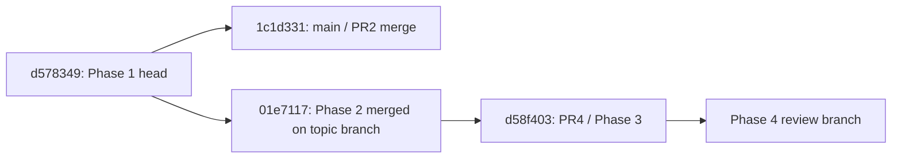

# Phase 4 Git integration assessment

Snapshot from fetched remote refs and GitHub PR metadata, not branch-name guesses:

| Ref / PR | Commit / state | What it contains |
| --- | --- | --- |
| main | `1c1d3319f0a1cb11fc3d9b1d0d4fd07062592ed9` | PR #2 merged; Phase 1 only |
| PR #2 | merged into main | Source head `d578349845ef65df82afe761ad4eeb6034dec288` |
| engine/extraction-phase1 | `01e711766307e1e6848efa5fbcedc4f96a5a320a` | Phase 1 plus merged Phase 2 |
| PR #3 | merged into engine/extraction-phase1 | Source head `59d774dd75f2e0d5ee85b2173f9a6e5d9cd77eb8` |
| PR #4 / engine/invitations-phase3 | open; `d58f403ab547d8cf2c437a1cb238f215203883e5` | Phase 3; targets engine/extraction-phase1 |
| engine/interop-readiness-phase4 | new branch from PR #4 head | Phase 4; targets engine/invitations-phase3 |

Main and the Phase 2/3 branches share merge-base `d578349`. Neither current Phase
2 nor Phase 3 head is an ancestor of main. `main...engine/extraction-phase1`
reports 1 main-only / 6 branch-only commits; `main...engine/invitations-phase3`
reports 1 / 9. Main's Phase 1 merge is its main-only commit. The merge of PR #3
into the old Phase 1 topic branch did **not** put Phase 2 into main.



## Recommended owner sequence — none executed here

1. Open/review an integration PR **engine/extraction-phase1 → main**. Confirm its
   net changes are Phase 2. Merge normally after checks/review, preserving commit
   ancestry; do not copy patches or force-push published branches.
2. Fetch main and verify `01e7117` is now an ancestor. Retarget **PR #4 to main**.
   Inspect its refreshed diff and rerun checks against the new base. The diff
   should contain Phase 3 only; merge only after owner review.
3. Fetch again and verify `d58f403` is an ancestor of main. Retarget the Phase 4
   PR **from engine/invitations-phase3 to main**. Inspect its diff and rerun checks.
   Review Phase 4 before any eventual merge.
4. Keep stack branches until dependent PRs are merged or explicitly retargeted.
   Do not rely on GitHub branch deletion to choose the intended base automatically.

Read-only checks for the owner after each step:

```sh
git fetch origin refs/heads/main:refs/remotes/origin/main
# After Phase 2 integration: exit 0 is required.
git merge-base --is-ancestor 01e711766307e1e6848efa5fbcedc4f96a5a320a origin/main
# After PR #4 merges: exit 0 is required.
git merge-base --is-ancestor d58f403ab547d8cf2c437a1cb238f215203883e5 origin/main
# Review the refreshed Phase 4 patch; do not merge based only on a count.
git diff --stat origin/main...engine/interop-readiness-phase4
git log --graph --oneline --decorate --all
```

This recommendation uses ordinary merge commits to keep the already published
ancestry easy to verify. If the owner requires squash merges, re-evaluate tree
and patch equivalence instead of assuming these ancestor checks will succeed;
do not rewrite the topic branches to hide the mismatch. If refs advance after
this snapshot, repeat the ancestry assessment before retargeting.

This work creates only the Phase 4 review PR. It does not create an automatic
integration/merge job, merge an existing PR, retarget PR #4, deploy, publish a
module, change licensing or rewrite history.
